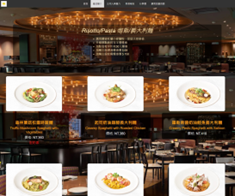
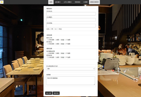

# "Taste of Italy" Restaurant Showcase Website (「義味濃情」義式餐廳形象官方網站)

[](https://developer.mozilla.org/en-US/docs/Web/HTML)
[](https://developer.mozilla.org/en-US/docs/Web/CSS)
[]()

A modern, responsive multi-page restaurant branding website for **"Taste of Italy" (義味濃情)**. Developed with semantic HTML5 and modular CSS3, the project emphasizes immersive visual storytelling, frosted-glass (glassmorphism) aesthetics, structured tabular data presentation, and rich interactive feedback mechanisms.

---

## 🎨 Design Highlights & Visual Architecture

* **Immersive Parallax Visuals**:
  * Utilizes `background-attachment: fixed` combined with `background-size: cover` to create seamless full-screen background scaling and immersive dining atmosphere.
* **Glassmorphism Card Aesthetics**:
  * Implements frosted-glass containers using semi-transparent RGBA backgrounds, soft border radiuses (`border-radius`), and multi-layered box shadows (`box-shadow`) to maintain high legibility over rich background imagery.
* **Micro-Interactions & Hover States**:
  * Menu product cards feature smooth scale transitions (`transform: scale(1.1)` and CSS `transition`) upon hover.
  * Navigation links incorporate active states (`.active`) and dynamic feedback (`:hover`).
* **Structured Data & Form Design**:
  * Leverages semantic table structures styled with zebra striping (`:nth-child(even)`) for clear presentation of business schedules and reports.
  * Features a styled multi-input customer feedback form optimized for responsiveness.

---

## 🖼️ Showcase

| Product Menu Showcase Page | Customer Feedback Form Page |
| :---: | :---: |
|  |  |

---

## 🛠️ Tech Stack & Properties

* **Markup**: Semantic HTML5 (`<header>`, `<nav>`, `<main>`, `<section>`, `<table>`, `<form>`)
* **Styling**: CSS3 Modules
  * Backgrounds: `background-attachment: fixed`, `background-size: cover`
  * Layout & Effects: Flexbox, Box Shadow, Border Radius, RGBA transparency
  * Pseudo-classes: `:hover`, `:active`, `:nth-child(even)`
  * Transitions: `transform: scale()`, `transition: all ease-in-out`

---

## 📂 Project Structure

```text
├── assets/                  # High-resolution screenshots and image assets
│   ├── restaurant_menu.png
│   └── restaurant_feedback.png
├── index.html               # Main website entry point
├── style.css                # Visual design and responsive layouts
└── README.md
🚦 How to View
Clone the repository:

Bash
git clone [https://github.com/Jimmy0330/italian-restaurant-website.git](https://github.com/Jimmy0330/italian-restaurant-website.git)
Open index.html directly in any web browser.